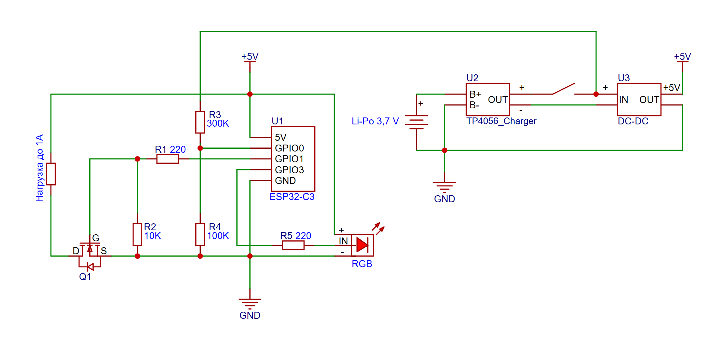

# ESP32-C3 — Wi-Fi управление нагрузкой

> Автономное устройство на базе **Adafruit QT Py ESP32-C3**, которое управляет
> питанием нагрузки (реле/ключ) через веб-интерфейс по Wi-Fi.

Прошивка написана на **C++17** с модульной архитектурой, неблокирующим
управлением сетью, хранением до 100 Wi-Fi сетей, режимом точки доступа,
мониторингом заряда аккумулятора (с калибровкой), обновлением прошивки по
воздуху (OTA), цветовой индикацией и аппаратным сторожевым таймером.

---

## ✨ Возможности

- 🌐 **Веб-интерфейс (SPA)** — страница управления с переключателем и индикаторами.
- 🔌 **Управление питанием** — включение/выключение нагрузки по HTTP (JSON API).
- 📡 **Неблокирующий Wi-Fi** — плата не зависает при старте без сети и сама переподключается.
- 🔄 **Автоматическое восстановление** — при обрыве связи соединение поднимается заново.
- 💾 **Хранение сетей (до 100)** — пользовательские сети сохраняются в NVS и переживают
  перезагрузку и отключение питания.
- 🏠 **Дежурная сеть** — сеть из прошивки как последний резерв, если сохранённые недоступны.
- 📶 **Режим точки доступа (AP + captive portal)** — для настройки без доступа к роутеру.
- 🔘 **Кнопка BOOT** — длинное нажатие (3 сек) включает/выключает точку доступа.
- 🔋 **Мониторинг аккумулятора** — измерение напряжения через ADC, 4 уровня заряда,
  индикация при включении, иконка батареи в интерфейсе и калибровка из веб-меню.
- 🔄 **OTA-обновление** — прошивка по воздуху: из PlatformIO или через браузер (в т.ч. с телефона).
- 💡 **Двухуровневая индикация** — встроенный светодиод + адресный RGB (цвет/дыхание/вспышка).
- 🛡 **Сторожевой таймер (TWDT)** — защита от зависаний, авто-перезагрузка.
- 🔍 **Диагностика** — в логах выводится причина последней перезагрузки.
- 🌍 **mDNS** — доступ по имени `http://relay.local` вместо IP-адреса.
- 🧱 **Модульная архитектура** — каждый модуль в отдельном файле.

---

## 🗂 Структура проекта

```text
.
|-- platformio.ini
|-- README.md
|-- .gitignore
|-- docs/
|   |-- schematic.png
|   |-- schematic.svg
|-- src/
    |-- main.cpp
    |-- config.hpp
    |-- log.hpp
    |-- log.cpp
    |-- power_controller.hpp
    |-- power_controller.cpp
    |-- wifi_storage.hpp
    |-- wifi_storage.cpp
    |-- wifi_manager.hpp
    |-- wifi_manager.cpp
    |-- ap_manager.hpp
    |-- ap_manager.cpp
    |-- indicator.hpp
    |-- indicator.cpp
    |-- rgb_indicator.hpp
    |-- rgb_indicator.cpp
    |-- battery.hpp
    |-- battery.cpp
    |-- ota_manager.hpp
    |-- ota_manager.cpp
    |-- watchdog.hpp
    |-- watchdog.cpp
    |-- web_server.hpp
    |-- web_server.cpp
    |-- web/
        |-- index_page.hpp
        |-- update_page.hpp
```

### Модули и их ответственность

| Модуль | Назначение |
| --- | --- |
| `config.hpp` | Единая точка всех настроек (пины, Wi-Fi, NVS, AP, батарея, OTA, WDT) |
| `log` | Логирование в Serial с уровнями `Debug/Info/Warn/Error` и проверкой формата |
| `power::Controller` | Управление силовым пином, хранение состояния питания |
| `wifi::Storage` | Хранение до 100 Wi-Fi сетей в NVS |
| `wifi::Manager` | Конечный автомат соединения, перебор сетей, suspend/resume |
| `ap::Manager` | Точка доступа + captive portal (DNS-перехват) |
| `indicator::Led` | Встроенный светодиод: горит / погашен / быстро мигает |
| `rgb::Led` | Адресный RGB (WS2812): цвет, «дыхание», вспышка |
| `battery::Monitor` | Измерение напряжения, 4 уровня заряда, процент, калибровка |
| `ota::Manager` | OTA-обновление прошивки по воздуху (ArduinoOTA) |
| `watchdog` | Инициализация TWDT, «кормление», вывод причины перезагрузки |
| `web::Server` | HTTP-маршруты (SPA + JSON API + загрузчик прошивки) и mDNS |
| `web::index_page` | HTML/CSS/JS главная страница управления |
| `web::update_page` | HTML страница веб-обновления прошивки |

---

## 🖼 Электрическая схема

Схема подключения находится в папке `docs/`:

| Файл | Формат | Назначение |
| --- | --- | --- |
| `schematic.png` | PNG | схема для просмотра (растровая) |
| `schematic.svg` | SVG | схема для редактирования (векторная) |



---

## 🔌 Карта пинов (важно, чтобы не путать)

| Пин | Назначение | Примечание |
| --- | --- | --- |
| `GPIO 1` | **Управление нагрузкой** | `HIGH` (3,3 В) = включено, `LOW` (0 В) = выключено |
| `GPIO 0` | **ADC аккумулятора** | через делитель R1=300k, R2=100k (коэфф. 4.0) |
| `GPIO 8` | **Встроенный светодиод** | инверсный: горит при `LOW` |
| `GPIO 9` | **Кнопка BOOT** | активный `LOW`, длинное нажатие = переключение AP |
| `GPIO 3` | **Адресный RGB (WS2812)** | пин данных `Din` |

> ⚠️ Частая ловушка: GPIO 1 (питание) и GPIO 8 (светодиод) — **разные пины с разной
> логикой**. Нагрузка работает по «активному HIGH», встроенный светодиод — по
> «активному LOW». Не измеряйте питание на 8-м пине — там всегда инверсия.

Все пины задаются в `config.hpp` — при смене платы достаточно поправить константы.

---

## 🚀 Как попасть в веб-интерфейс

### Что происходит при первом включении

1. Плата загружается, питание включается автоматически (зелёный индикатор).
2. Через 3 секунды RGB-светодиод один раз показывает уровень заряда аккумулятора.
3. Устройство пробует подключиться к Wi-Fi **по списку**:
   - сначала пользовательские сети из памяти (самая новая — приоритетнее);
   - затем дежурная сеть из прошивки.
4. После подключения плата получает IP-адрес и готова принимать запросы.

IP-адрес смотрите в Serial-мониторе (115200):

```log
[INFO ][WiFi] подключено к "HomeWiFi", IP: 192.168.1.42
[INFO ][WiFi] веб-интерфейс: http://192.168.1.42
[INFO ][HTTP] mDNS включён: http://relay.local
```

---

### Способ 1. Через дежурную сеть (первое включение)

1. В `src/config.hpp` подставьте свою сеть:

```cpp
inline constexpr const char* kDefaultWifiSsid     = "WIFI-RELAY";
inline constexpr const char* kDefaultWifiPassword = "12345678";
```

1. Соберите и залейте:

```bash
pio run -t upload
pio device monitor
```

1. Откройте в браузере `http://192.168.x.x` (IP из лога) или `http://relay.local`.

---

### Способ 2. Через точку доступа (AP) — без роутера

**Включение AP:**

- Кнопка BOOT — удерживайте 3 секунды (встроенный LED быстро мигает, RGB голубой).
- Или из веб-интерфейса: Настройки → «Включить точку доступа».

**Подключение:**

1. Подключитесь к Wi-Fi сети `Relay-Setup` (открытая).
2. Откройте `http://192.168.4.1`.
3. Введите свою сеть, сохраните, перезагрузитесь.

---

### Способ 3. Через сохранённые сети (после первой настройки)

Устройство само перебирает сохранённые сети, затем дежурную. Дальше — по IP или `relay.local`.

---

## ⚙️ Настройка

Все параметры в **`src/config.hpp`**:

```cpp
namespace relay::config {

// Дежурная Wi-Fi сеть (последний резерв)
inline constexpr const char* kDefaultWifiSsid     = "ИМЯ_ВАШЕЙ_СЕТИ";
inline constexpr const char* kDefaultWifiPassword = "ПАРОЛЬ_ВАШЕЙ_СЕТИ";

// Хранилище сетей
inline constexpr uint16_t    kMaxSavedNetworks     = 100;
inline constexpr const char* kStorageNamespace     = "relay";
inline constexpr uint32_t    kWifiConnectTimeoutMs = 12000;

// Режим точки доступа (AP)
inline constexpr const char* kApSsid     = "Relay-Setup";
inline constexpr const char* kApPassword = "";
inline constexpr uint8_t      kApChannel = 1;

// Кнопка BOOT
inline constexpr int      kBootButtonPin  = 9;
inline constexpr uint32_t kBootLongPressMs = 3000;

// Встроенный светодиод
inline constexpr int  kLedPin         = 8;
inline constexpr bool kLedActiveLevel = false;

// Адресный RGB (WS2812)
inline constexpr int kNeoPixelPin   = 3;
inline constexpr int kNeoPixelCount = 1;

// Батарея (ADC)
inline constexpr int      kBatteryAdcPin      = 0;
inline constexpr float    kBatteryDivider     = 4.0f;
inline constexpr float    kBatteryCalibrationDefault = 1.0f;
inline constexpr uint32_t kBatteryFullMv  = 4000;   // >= 4.0 В = 100%
inline constexpr uint32_t kBatteryHalfMv  = 3800;   // 3.8-4.0 В = половина
inline constexpr uint32_t kBatteryLowMv   = 3600;   // 3.6-3.8 В = низкий
inline constexpr uint32_t kBatteryEmptyMv = 3400;   // 0% (ниже — отключение)

// Настройки (NVS)
inline constexpr const char* kSettingsNamespace = "relay_cfg";

// OTA (обновление по воздуху)
inline constexpr const char* kOtaHostname = "relay";
inline constexpr const char* kOtaPassword = "relay12345";  // ⚠️ смените!

// Пин питания (активный HIGH)
inline constexpr int kPowerPin = 1;

// Тайминги
inline constexpr uint32_t kSerialBaud       = 115200;
inline constexpr uint32_t kReconnectDelayMs = 5000;

// Сторожевой таймер
inline constexpr uint32_t kWatchdogTimeoutSec = 10;

// HTTP / mDNS
inline constexpr uint16_t    kHttpPort     = 80;
inline constexpr const char* kMdnsHostname = "relay";

}
```

---

## 🔋 Мониторинг аккумулятора

Измерение через ADC и делитель:

```text
Аккумулятор(+) --[R1=300k]--+--[R2=100k]-- GND
                            |
                          ADC пин (GPIO0)
```

Коэффициент делителя = (R1 + R2) / R2 = 4.0.

### Пороги заряда (подобраны под ESP32-C3)

| Уровень | Напряжение | Веб-иконка | Цвет |
| --- | --- | --- | --- |
| Полный (100%) | >= 4000 мВ | полная заливка | зелёный |
| Половина | 3800–3999 мВ | половина заливки | оранжевый |
| Низкий | 3600–3799 мВ | маленькое деление | красный |
| Критический | < 3600 мВ | пустой контур, **мигает** | красный |

> Пороги подобраны так, чтобы оставался запас до фактического отключения платы
> (LDO 3,3 В перестаёт держать питание около 3,2–3,3 В).

### Калибровка

1. На главном экране найдите иконку батареи (под статус-баром справа).
2. Нажмите на **«⋮»** (три точки) рядом с батареей.
3. Введите калибровочный множитель и нажмите «Сохранить в память».

Формула подбора:

```text
калибровка = реальное_напряжение (мультиметр) / показанное_платой
```

Значение сохраняется в NVS и переживает перезагрузку. При сохранении RGB-светодиод
мигает фиолетовым.

### Индикация заряда при включении (один раз, через 3 сек)

| Уровень | Цвет | Мигание |
| --- | --- | --- |
| Полный | 🟢 зелёный | 5 раз |
| Половина | 🟠 оранжевый | 5 раз |
| Низкий | 🔴 красный | 5 раз |
| Критический | 🔴 красный | 15 раз очень быстро |

---

## 💡 Индикация

### Встроенный светодиод (GPIO 8)

| Состояние | Поведение |
| --- | --- |
| Питание включено | горит |
| Питание выключено | погашен |
| Точка доступа активна | быстрое мигание |

### Адресный RGB (WS2812)

| Событие | Цвет | Эффект |
| --- | --- | --- |
| Питание включено | 🟢 Зелёный | горит |
| Питание выключено | 🔴 Красный | горит |
| Точка доступа активна | 🔵 Голубой | «дыхание» |
| Запись в NVS (сеть/калибровка) | 🟣 Фиолетовый | мигание |
| Начало OTA | 🔵 Синий | 5 вспышек |
| OTA успешно | 🟢 Зелёный | 3 вспышки |
| OTA ошибка | 🔴 Красный | 5 вспышек |

---

## 🔄 Обновление прошивки (OTA)

### Вариант A — с телефона (веб-загрузчик)

1. Соберите прошивку на компьютере:

```bash
pio run
```

Файл: `.pio/build/adafruit_qtpy_esp32c3/firmware.bin`.

1. Передайте `.bin` на телефон.
2. Подключите телефон к той же Wi-Fi сети, что и устройство.
3. Откройте в браузере:
   - через меню: Настройки → Система → **«Обновление прошивки (OTA)»**;
   - или напрямую: `http://relay.local/update`.
4. Введите пароль OTA, выберите файл, нажмите «Обновить».

### Вариант B — с компьютера (PlatformIO)

```bash
pio run -t upload --upload-port relay.local
```

> ⚠️ Смените пароль `kOtaPassword` на свой. Не выключайте питание во время обновления.

---

## 🌐 HTTP API

### Питание

| Метод | Путь | Описание |
| --- | --- | --- |
| `GET` | `/api/state` | Состояние питания |
| `POST` | `/api/power?on=1` | Включить/выключить питание |

### Батарея

| Метод | Путь | Описание |
| --- | --- | --- |
| `GET` | `/api/battery` | Измерить заряд `{"level":0,"voltage_mv":3900,"percent":100}` |
| `GET` | `/api/battery/config` | Текущая калибровка |
| `POST` | `/api/battery/config` | Сохранить калибровку `{"calibration":0.9205}` |

### Wi-Fi (сети)

| Метод | Путь | Описание |
| --- | --- | --- |
| `GET` | `/api/wifi/status` | Текущая сеть, IP, сигнал |
| `GET` | `/api/wifi/networks` | Список сохранённых сетей |
| `POST` | `/api/wifi/add` | Добавить сеть |
| `POST` | `/api/wifi/remove` | Удалить сеть |

### Точка доступа

| Метод | Путь | Описание |
| --- | --- | --- |
| `GET` | `/api/ap/status` | Состояние AP |
| `POST` | `/api/ap/start` | Включить AP |
| `POST` | `/api/ap/stop` | Выключить AP |

### Обновление прошивки

| Метод | Путь | Описание |
| --- | --- | --- |
| `GET` | `/update` | Страница веб-загрузчика |
| `POST` | `/update` | Приём файла прошивки (multipart) |

### Служебное

| Метод | Путь | Описание |
| --- | --- | --- |
| `GET` | `/api/info` | Uptime, память, состояние |
| `GET` | `/api/version` | Версия прошивки |
| `POST` | `/api/reboot` | Перезагрузка |

---

## 📝 Пример логов

```log
[INFO ][Загрузка] ===== запуск =====
[INFO ][Загрузка] версия прошивки: V1.0.2
[INFO ][Загрузка] причина перезагрузки: включение питания
[INFO ][RGB] адресный светодиод инициализирован (Adafruit NeoPixel), пин 3
[INFO ][Питание] ВКЛ (на пине: HIGH)
[INFO ][Батарея] монитор инициализирован (пин 0, делитель 4.0, калибровка 1.0000)
[INFO ][Хранилище] загружено сетей: 2
[INFO ][WiFi] пробую сеть "HomeWiFi"...
[INFO ][WiFi] подключено к "HomeWiFi", IP: 192.168.1.42
[INFO ][WiFi] веб-интерфейс: http://192.168.1.42
[INFO ][HTTP] сервер запущен на порту 80
[INFO ][HTTP] mDNS включён: http://relay.local
[INFO ][OTA] обновление по воздуху готово: relay.local
[DEBUG][WDT] loopTask уже подписан ядром Arduino
[INFO ][WDT] сторожевой таймер активен (таймаут задаёт ядро)
[INFO ][Батарея] напряжение 3920 мВ, уровень 1, заряд 83%
[INFO ][Загрузка] инициализация завершена
```

---

## 🛡 Сторожевой таймер (Watchdog)

- Таймаут задаётся ядром Arduino (по умолчанию 5 секунд).
- Если `loop()` зависнет — плата перезагрузится.
- При старте выводится причина перезагрузки.
- Во время OTA-обновления сторожевой таймер «кормится» вручную в обработчике
  чанков — поэтому прошивка по воздуху не прерывается.

---

## 📡 Поведение радио (излучение)

| Режим | Излучает? |
| --- | --- |
| Подключена, ожидание | Почти нет (редкие keep-alive) |
| Идёт запрос | Да, коротко — только ответ |
| Нет сети | Да, коротко каждые 12 сек |
| Точка доступа | Да, маячки (beacon) |

---

## 🔧 Используемые технологии

- **C++17** — `inline constexpr`, `enum class`, вложенные namespace, `[[nodiscard]]`.
- **ESP32 Arduino Core 3.x** (ESP-IDF 5.x).
- **PlatformIO** — система сборки.
- **ArduinoJson** — работа с JSON.
- **Preferences (NVS)** — хранение сетей и настроек.
- **DNSServer** — captive portal.
- **Adafruit NeoPixel** — адресный светодиод.
- **esp_adc/adc_oneshot** — измерение напряжения.
- **ArduinoOTA / Update** — обновление по воздуху.
- **ESPmDNS** — доступ по имени хоста.
- **Task Watchdog (TWDT)** — защита от зависаний.

---

## 🧭 Дорожная карта (идеи для развития)

- [ ] Сканирование эфира — выбор сети из списка.
- [ ] Автовыход из режима AP по таймауту.
- [ ] Защита веб-интерфейса (HTTP Basic Auth или PIN).
- [ ] Экспорт/импорт списка сетей.
- [ ] Ручная расстановка приоритета сетей.
- [ ] Глубокий сон (deep sleep) для экономии заряда.

---

## 📄 Лицензия

Проект предоставляется «как есть» (MIT). Используйте свободно в своих целях.
